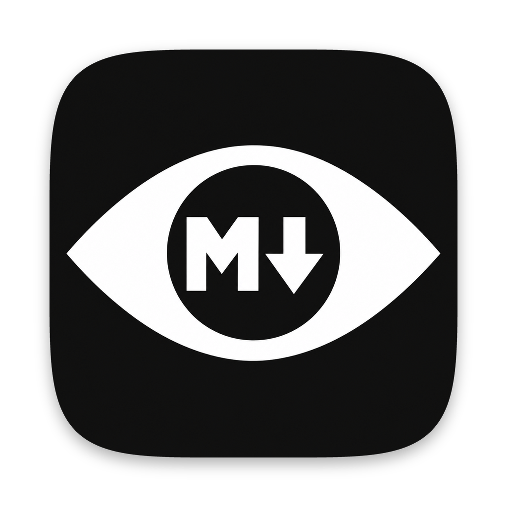
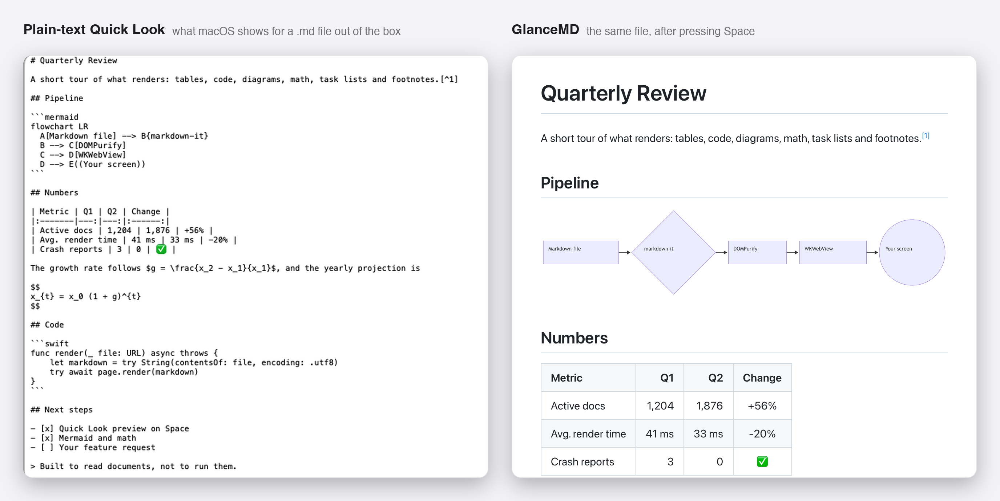
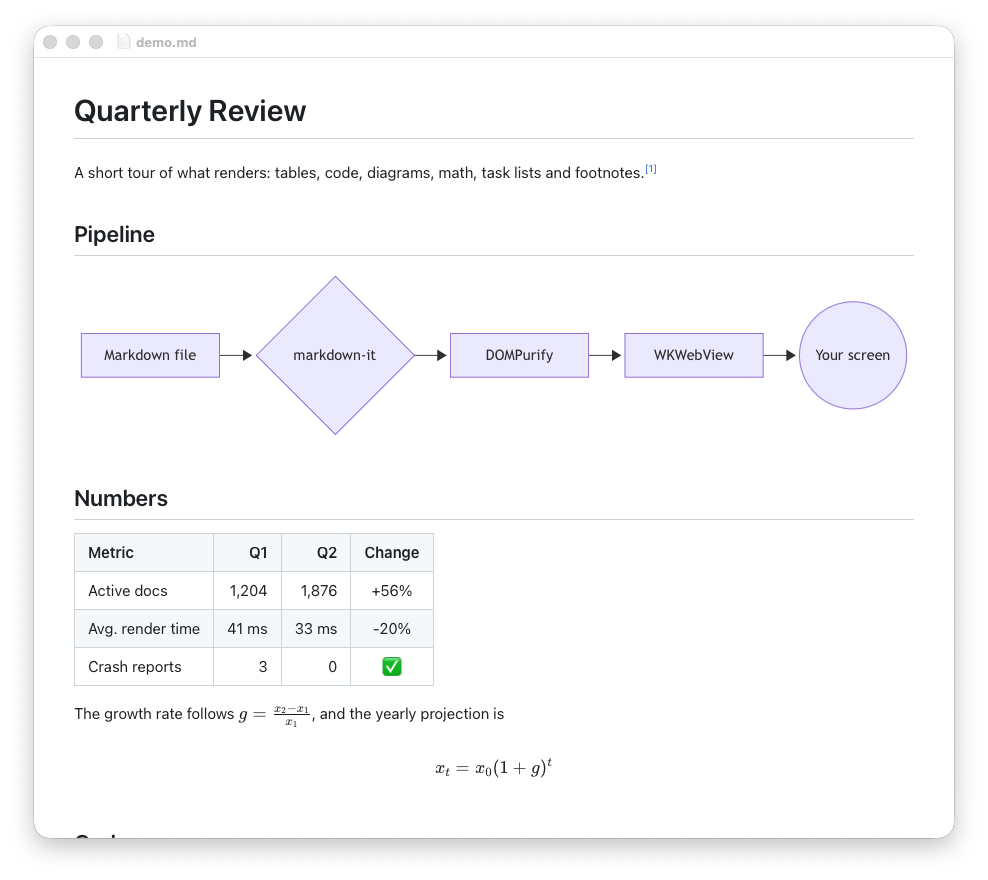
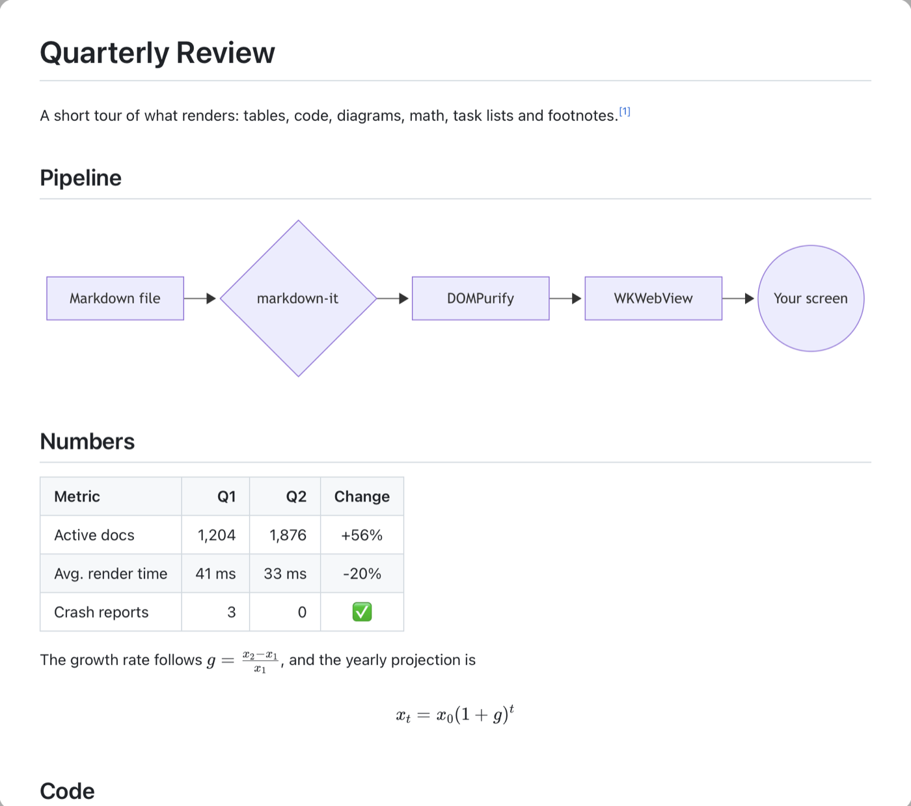

<div align="center">



# GlanceMD

**Markdown en macOS, de un vistazo.**

Selecciona un archivo `.md` en el Finder, pulsa <kbd>Espacio</kbd> y léelo renderizado: tablas, diagramas Mermaid, fórmulas, código resaltado, notas al pie, listas de tareas y las imágenes que están junto al archivo.


[English](README.md) · [한국어](README.ko.md) · [简体中文](README.zh-CN.md) · [日本語](README.ja.md) · **Español** · [Português (BR)](README.pt-BR.md) · [Deutsch](README.de.md) · [Français](README.fr.md)

[](https://github.com/gksdud6330/glance-md/releases/latest)
[](#instalación)
[](#instalación)
[](LICENSE)

[](https://github.com/gksdud6330/glance-md/releases/latest)

Gratis y de código abierto · funciona sin conexión · macOS 13 o posterior

</div>

## Antes y después

El mismo archivo, la misma barra espaciadora. A la izquierda, la vista previa de texto plano que trae macOS. A la derecha, GlanceMD.



## Qué obtienes

- **Un Quick Look que entiende Markdown.** Selecciona un archivo, pulsa Espacio y lee. Las imágenes locales que están junto al archivo también aparecen. Haz doble clic en una palabra de la vista previa para seleccionarla y <kbd>⌘</kbd><kbd>C</kbd> para copiarla; no abre el archivo.
- **Renderizado correcto.** CommonMark + GitHub Flavored Markdown con [markdown-it](https://github.com/markdown-it/markdown-it): listas anidadas, tablas alineadas con celdas vacías y barras verticales escapadas, notas al pie, listas de tareas, encabezados setext, `<details>`.
- **Diagramas y fórmulas.** Los bloques ` ```mermaid ` se convierten en diagramas; `$…$`, `$$…$$` y ` ```math ` se renderizan con KaTeX.
- **Un visor cuando lo necesitas.** Abre un archivo `.md` con GlanceMD (o hazla tu app predeterminada para Markdown y bastará con un doble clic) para ver el mismo renderizado en una ventana pequeña con pestañas. Se vuelve a renderizar cuando el archivo cambia (incluidos los guardados atómicos de los editores) y conserva la posición de desplazamiento.
- **Ajustes.** Abre GlanceMD (o pulsa <kbd>⌘</kbd><kbd>,</kbd>) para activar o desactivar la vista previa de Quick Look y para que el texto se copie al portapapeles en cuanto lo seleccionas (desactivado por defecto).
- **Se siente nativo.** Modo claro y oscuro, zoom (<kbd>⌘</kbd><kbd>+</kbd> / <kbd>⌘</kbd><kbd>-</kbd> / pellizco), copiar, los enlaces se abren en tu navegador.
- **Seguro para abrir archivos que no escribiste tú.** Consulta [Seguridad](#seguridad).
- **Sin conexión.** Todas las bibliotecas van incluidas. No se descarga nada de un CDN.
- **Pequeño.** Unos cientos de líneas de Swift alrededor de WKWebView. Binario universal (Apple silicon + Intel), macOS 13 o posterior.

<details>
<summary>Capturas: la ventana del visor y el panel de Quick Look</summary>





</details>

## Instalación

### Descarga

1. Descarga `GlanceMD-<version>.zip` desde [Releases](https://github.com/gksdud6330/glance-md/releases), descomprímelo y mueve `GlanceMD.app` a `/Applications`.
2. GlanceMD no está notarizado (está firmado ad hoc, sin un Apple Developer ID de pago), así que macOS bloquea el primer arranque. Ábrelo una vez, cierra el aviso y ve a **Ajustes del Sistema → Privacidad y seguridad** y pulsa **Abrir de todos modos**. O bien:
   ```bash
   xattr -dr com.apple.quarantine /Applications/GlanceMD.app
   ```
3. Abre GlanceMD una vez para que macOS registre su extensión de Quick Look. Después selecciona un archivo `.md` en el Finder y pulsa Espacio.

Si Espacio sigue mostrando texto plano, ejecuta `qlmanage -r` y comprueba que **GlanceMD Quick Look** esté activado en **Ajustes del Sistema → General → Ítems de inicio y extensiones → Quick Look**.

### Compilar desde el código fuente

Requiere Xcode o las Xcode Command Line Tools.

```bash
git clone https://github.com/gksdud6330/glance-md.git
cd glance-md
./install.sh        # compila build/GlanceMD.app y lo instala en /Applications
```

`./build.sh` solo compila, sin instalar.

### Hacerlo la app predeterminada para Markdown (opcional)

En el Finder, **Obtener información** sobre cualquier archivo `.md` → **Abrir con: GlanceMD** → **Cambiar todo…**

## Seguridad

Un archivo Markdown puede contener HTML en bruto, así que un visor que lo renderice de forma ingenua también ejecutará cualquier script que lleve el archivo. GlanceMD trata todos los documentos como no confiables:

- El HTML renderizado pasa por [DOMPurify](https://github.com/cure53/DOMPurify): se eliminan `<script>`, los manejadores `on*`, las URL `javascript:`, `<iframe>`, `<form>` y `<style>`.
- La página se ejecuta bajo una Content Security Policy que solo permite los scripts incluidos, así que incluso el marcado que se cuele no puede ejecutarse.
- Mermaid se ejecuta con `securityLevel: 'strict'`; KaTeX con `trust: false`, de modo que `\href{javascript:…}` no se convierte en enlace.
- Hacer clic en un enlace a un archivo local nunca lo abre. Los enlaces `.md` se abren en GlanceMD; cualquier otro solo se muestra en el Finder.
- La extensión de Quick Look está aislada en un sandbox con acceso de solo lectura a archivos, que necesita para mostrar las imágenes junto al documento.

[`samples/stress-test.md`](samples/stress-test.md) pone a prueba todo esto. Ábrelo con GlanceMD: cada línea de la última sección debería mostrar `[안전]` («seguro» en coreano).

## Cómo funciona

```
src/app/          la app visora (ventanas, pestañas, recarga en vivo, menús)
src/quicklook/    la extensión de vista previa de Quick Look (en sandbox)
src/shared/       MarkdownPage: carga la página de renderizado y renderiza un archivo en ella
web/              la página de renderizado: markdown-it → DOMPurify → Mermaid/KaTeX/highlight.js
samples/          una demo de funciones y una prueba de estrés de renderizado/seguridad
```

La app y la extensión renderizan a través de la misma página `web/`, así que una vista previa de Quick Look y una ventana del visor siempre se ven idénticas. Mermaid (unos 5 MB) solo se carga cuando el documento contiene un diagrama.

## Limitaciones

- No está notarizado; consulta los pasos de instalación.
- Es un visor de solo lectura: no edita ni exporta a PDF.
- La primera vista previa tras iniciar sesión puede tardar uno o dos segundos mientras arranca WebKit.
- Probado en macOS 26 con Apple silicon.

## Créditos

GlanceMD es una capa fina sobre excelentes proyectos de código abierto: [markdown-it](https://github.com/markdown-it/markdown-it) con los plugins [footnote](https://github.com/markdown-it/markdown-it-footnote), [task list](https://github.com/revin/markdown-it-task-lists) y [texmath](https://github.com/goessner/markdown-it-texmath), [KaTeX](https://katex.org), [Mermaid](https://mermaid.js.org), [highlight.js](https://highlightjs.org) y [DOMPurify](https://github.com/cure53/DOMPurify). Sus licencias están en [`web/vendor/THIRD_PARTY_LICENSES.md`](web/vendor/THIRD_PARTY_LICENSES.md).

## Licencia

[MIT](LICENSE)
