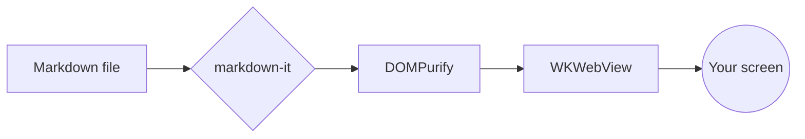

# Quarterly Review

A short tour of what renders: tables, code, diagrams, math, task lists and footnotes.[^1]

## Pipeline



## Numbers

| Metric | Q1 | Q2 | Change |
|:-------|---:|---:|:------:|
| Active docs | 1,204 | 1,876 | +56% |
| Avg. render time | 41 ms | 33 ms | -20% |
| Crash reports | 3 | 0 | ✅ |

The growth rate follows $g = \frac{x_2 - x_1}{x_1}$, and the yearly projection is

$$
x_{t} = x_0 (1 + g)^{t}
$$

## Code

```swift
func render(_ file: URL) async throws {
    let markdown = try String(contentsOf: file, encoding: .utf8)
    try await page.render(markdown)
}
```

## Next steps

- [x] Quick Look preview on Space
- [x] Mermaid and math
- [ ] Your feature request

> Built to read documents, not to run them.

[^1]: Everything is bundled, so it works offline.
