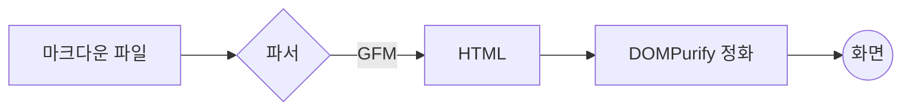
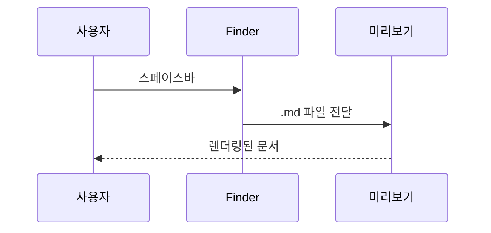
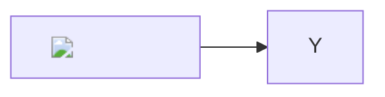

# 마크다운 렌더링·보안 스트레스 테스트

각 절 끝의 "기대:" 줄이 정상 렌더링 결과다. 화면이 기대와 다르면 그 항목은 깨진 것이다.

## 1. 중첩 목록과 번호

- 1단계 A
  - 2단계 A-1
    - 3단계 A-1-a
  - 2단계 A-2
- 1단계 B

1. 첫째
   1. 첫째의 하위 1
   2. 첫째의 하위 2
2. 둘째

다른 목록:

5. 5번부터 시작
6. 여섯째

기대: 들여쓰기가 3단계까지 보이고, 마지막 목록은 5, 6으로 번호가 붙는다.

## 2. 코드 안의 특수문자

인라인 코드: `a * b * c`, `**kwargs`, `<div>태그</div>`, `snake_case_name`

```python
def f(*args, **kwargs):
    return a * b * c  # 곱셈 두 번
```

```c++
std::vector<int> v;  // 언어 이름에 기호가 있는 펜스
```

~~~bash
echo "물결 펜스"
~~~

    네 칸 들여쓴 코드 블록 * 별표 * 그대로

기대: 모든 별표와 꺾쇠가 글자 그대로 보이고, 코드 블록 네 개가 모두 회색 상자로 보인다.

## 3. 강조 문법 변형과 이스케이프

_밑줄 기울임_, __밑줄 굵게__, \*이스케이프된 별표\*, 2 * 3 * 4 = 24, 파일명 my_file_name.md

기대: 앞의 둘만 기울임/굵게이고, 이스케이프된 별표와 곱셈식은 글자 그대로 보인다.

## 4. 각주

각주가 달린 문장입니다.[^1] 이름 붙은 각주도 있습니다.[^note]

[^1]: 첫 번째 각주 내용.
[^note]: 이름 붙은 각주 내용.

기대: 본문에 위첨자 번호가 붙고, 문서 끝에 각주 목록이 모인다.

## 5. 복잡한 표

| 항목 | 왼쪽 정렬 | 가운데 정렬 | 오른쪽 정렬 |
|:-----|:----------|:-----------:|------------:|
| 정렬 | L | C | R |
| 빈 칸 |  | 왼쪽 칸이 비어 있음 | 3 |
| 파이프 | `a \| b` | a \| b | 끝 |
| **굵게** | [링크](https://example.com) | `코드` | 4 |

열 이름 | 바깥 파이프 없는 표
--- | ---
값1 | 값2

기대: 첫 표는 4열이고 정렬이 적용되며, 빈 칸은 자리를 지키고, `a | b`는 한 칸 안에 들어간다. 두 번째 표도 표로 보인다.

## 6. 이미지와 링크


[괄호가 든 URL](https://en.wikipedia.org/wiki/Markdown_(disambiguation)), 자동 링크 <https://github.com/markdown-it/markdown-it>, 참조 링크 [CommonMark][ref]

[ref]: https://commonmark.org

기대: 이미지 두 장이 보이고, 링크 세 개가 모두 클릭 가능한 링크로 보인다.

## 7. 문단과 줄바꿈

이 문장은
두 줄로 나눠 썼지만 한 문단이다.

줄 끝 공백 두 개로  
강제 줄바꿈.

기대: 첫 문단은 한 줄로 이어지고, 두 번째는 정확히 두 줄이다.

## 8. 인용

> 인용 1단계
> 이어지는 줄
>
> > 인용 2단계
>
> - 인용 안 목록

기대: 2단계 인용이 1단계 안에 들어가고, 인용 안 목록이 보인다.

## 9. 제목 변형

#해시 뒤 공백 없음

Setext 제목
-----------

기대: 첫 줄은 일반 문장, 두 번째는 h2 제목이다.

## 10. 체크리스트, 취소선, 안전한 HTML

- [x] 완료한 일
- [ ] 남은 일
  - [ ] 하위 할 일

~~취소선~~ 그리고 <kbd>Cmd</kbd>+<kbd>C</kbd>

<details><summary>접힌 내용 (클릭)</summary>

펼치면 보이는 **마크다운** 내용
</details>

기대: 체크박스 3개(하위 포함), 취소선, 키보드 표시, 접히는 영역이 보인다.

## 11. Mermaid 다이어그램





```mermaid
flowchart LR
  A[[문법 오류 -->
```

기대: 다이어그램 두 개가 그림으로 보이고, 세 번째는 문법 오류 상자로 보인다.

## 12. 수식

인라인 수식 $E = mc^2$ 와 $\sum_{i=1}^{n} i = \frac{n(n+1)}{2}$, 백틱 인라인 $`\sqrt{2}`$

$$
\int_{-\infty}^{\infty} e^{-x^2}\,dx = \sqrt{\pi}
$$

```math
\begin{pmatrix} a & b \\ c & d \end{pmatrix}
```

가격 표기 $5 와 $10 은 수식이 아니다.

기대: 수식 다섯 개가 조판되어 보이고, 마지막 줄의 달러 금액은 글자 그대로다.

## 13. 보안: 문서 안 스크립트와 로컬 파일 읽기

<p id="xss">[안전] onerror 핸들러가 실행되지 않았다.</p>


<p id="xss2">[안전] script 태그가 실행되지 않았다.</p>
<script>document.getElementById('xss2').textContent = '[위험] 문서 안 script 태그가 실행됨';</script>


<p id="leak-out">[안전] 문서 밖 로컬 파일을 읽지 못했다.</p>
<script>var s = document.getElementById('leak').src; if (s.indexOf('base64,') > 0) { document.getElementById('leak-out').textContent = '[위험] 문서 밖 로컬 파일 내용을 스크립트가 읽음: ' + atob(s.split('base64,')[1]); }</script>

<p id="xss3">[안전] 다이어그램 안 onerror 핸들러가 실행되지 않았다.</p>



수식 안 링크: $\href{javascript:alert(1)}{눌러도 아무 일 없음}$

기대: 네 줄 모두 [안전]으로 보이고, 수식 안 javascript 링크는 링크로 만들어지지 않는다.
